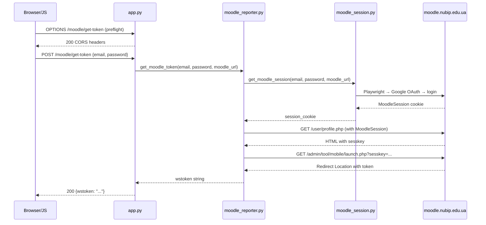

# План: POST /moodle/get-token

## Мета

Створити публічний endpoint `POST /moodle/get-token`, який приймає `email` + `password`, виконує Playwright → Google OAuth → session → sesskey → launch.php → token пайплайн і повертає готовий `wstoken`. Endpoint має CORS підтримку.

## Де додати

Маршрут додається **безпосередньо в [`app.py`](app.py)** (не в блюпринт), щоб отримати точний URL `/moodle/get-token` без ускладнень із префіксами.

## Архітектура



## Що змінюється

| Файл | Дія | Опис |
|------|------|------|
| [`app.py`](app.py) | **Змінити** | Додати import `get_moodle_token`, CORS `after_request`, маршрут `/moodle/get-token` |
| [`requirements.txt`](requirements.txt) | **Перевірити** | Впевнитись що `playwright>=1.40.0` та `requests>=2.31.0` є |

**Жодних нових файлів не створюється.** Вся логіка вже існує в [`moodle_reporter.py:127`](blueprints/moodle_session/moodle_reporter.py:127).

## Покрокова реалізація

### Крок 1: Додати CORS обробник в [`app.py`](app.py)

Після `app.secret_key` (рядок ~49) додати `after_request` обробник, який додає CORS заголовки **тільки** для `/moodle/get-token`:

```python
@app.after_request
def add_cors_headers(response):
    if request.path == '/moodle/get-token':
        response.headers['Access-Control-Allow-Origin'] = '*'
        response.headers['Access-Control-Allow-Methods'] = 'POST, OPTIONS'
        response.headers['Access-Control-Allow-Headers'] = 'Content-Type'
    return response
```

### Крок 2: Додати import `get_moodle_token`

В самий верх [`app.py`](app.py), після існуючих імпортів (~рядок 6), додати:

```python
from blueprints.moodle_session.moodle_reporter import get_moodle_token
```

### Крок 3: Додати маршрут [`POST /moodle/get-token`](app.py)

Перед `if __name__ == '__main__':` (в кінці файла, після маршруту logout) додати:

```python
@app.route('/moodle/get-token', methods=['POST', 'OPTIONS'])
def moodle_get_token():
    """
    Публічний endpoint для отримання Moodle API token.
    Не потребує @login_required — автентифікація через email+password.
    Приймає:  {"email": "...", "password": "...", "moodle_url": "..."} (moodle_url опціонально)
    Повертає: {"wstoken": "..."} або {"error": "..."} з відповідним HTTP статусом.
    """
    if request.method == 'OPTIONS':
        return '', 200

    data = request.get_json(silent=True)
    if not data:
        return jsonify({'error': 'Request body is required'}), 400

    email = data.get('email', '').strip()
    password = data.get('password', '')
    moodle_url = data.get('moodle_url', 'https://moodle.nubip.edu.ua').rstrip('/')

    if not email or not password:
        return jsonify({'error': 'email and password are required'}), 400

    logger.info(f"[MOODLE_GET_TOKEN] Отримуємо токен для {email}")

    token = get_moodle_token(email, password, moodle_url)
    if not token:
        logger.warning(f"[MOODLE_GET_TOKEN] Не вдалося отримати токен для {email}")
        return jsonify({'error': 'Failed to obtain Moodle token. Check credentials.'}), 401

    logger.info(f"[MOODLE_GET_TOKEN] Токен успішно отримано для {email}")
    return jsonify({'wstoken': token})
```

### Крок 4: Перевірити [`requirements.txt`](requirements.txt)

Переконатись що файл містить (він вже має, але перевірити):
```
playwright>=1.40.0
requests>=2.31.0
```

## Адреса та синтаксис

**URL:** `POST https://openclaw.tailf549b1.ts.net/moodle/get-token`

**Body (JSON):**
```json
{
    "email": "user@gmail.com",
    "password": "user_password",
    "moodle_url": "https://moodle.nubip.edu.ua"
}
```
`moodle_url` — опціонально, за замовчуванням `https://moodle.nubip.edu.ua`

**Успішна відповідь (200):**
```json
{
    "wstoken": "a1b2c3d4e5f6..."
}
```

**Помилка (400) — немає даних:**
```json
{
    "error": "email and password are required"
}
```

**Помилка (401) — невірні credentials:**
```json
{
    "error": "Failed to obtain Moodle token. Check credentials."
}
```

## Тестування

```bash
# Успішний запит
curl -X POST https://openclaw.tailf549b1.ts.net/moodle/get-token \
  -H "Content-Type: application/json" \
  -d '{"email":"your_email@gmail.com","password":"your_password"}'

# Відповідь: {"wstoken":"abc123..."}

# Помилка: без пароля
curl -X POST https://openclaw.tailf549b1.ts.net/moodle/get-token \
  -H "Content-Type: application/json" \
  -d '{"email":"test@test.com"}'

# Відповідь: {"error":"email and password are required"} (400)

# CORS preflight
curl -X OPTIONS https://openclaw.tailf549b1.ts.net/moodle/get-token \
  -H "Origin: https://example.com" \
  -H "Access-Control-Request-Method: POST" \
  -v
# Має повернути Access-Control-Allow-Origin: *
```

## Потенційні ризики

1. **Playwright timeout** — `get_moodle_session()` може виконуватись 20-30+ секунд. Це синхронний виклик, тому клієнт має чекати.
2. **Google Challenge/CAPTCHA** — якщо Google покаже challenge сторінку, playwright не зможе її пройти. Кешування сесії (`moodle_session.py:8`) на 1 годину зменшує частоту логінів.
3. **Блокування акаунту** — часті автоматичні логіни можуть викликати підозру в Google. Кешування сесії мінімізує це.
