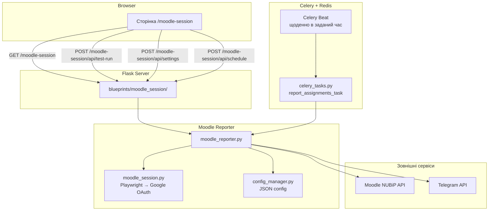

# План: Moodle Session Blueprint — Сторінка керування звітами

## Мета

Створити окремий Flask blueprint `moodle_session` зі сторінкою, де можна:
1. **Тестувати** — запустити скрипт вручну (отримати завдання з Moodle і відправити у Telegram)
2. **Налаштовувати розклад** — задати час автоматичного щоденного запуску через Celery Beat
3. **Керувати налаштуваннями** — Telegram bot token, chat IDs (через кому), Moodle email/пароль — усе через UI

## Архітектура



## Структура файлів

| Файл | Дія | Опис |
|------|------|------|
| `blueprints/moodle_session/__init__.py` | **Створити** | Реєстрація Blueprint |
| `blueprints/moodle_session/routes.py` | **Створити** | Flask-роути сторінки |
| `blueprints/moodle_session/moodle_reporter.py` | **Створити** | Портування reporter.js → Python |
| `blueprints/moodle_session/config_manager.py` | **Створити** | Читання/запис JSON-конфігу |
| `blueprints/moodle_session/celery_tasks.py` | **Створити** | Celery задачі для звіту |
| `blueprints/moodle_session/templates/moodle_session/index-moodle.html` | **Створити** | HTML-шаблон сторінки |
| `blueprints/doc_generator/celery_worker.py` | **Змінити** | Додати include на moodle_session.celery_tasks |
| `app.py` | **Змінити** | Зареєструвати blueprint, прибрати старий route `/moodle/session` |

## Детальний план кроків

### Крок 1: Створити `__init__.py` для blueprint

Файл: [`blueprints/moodle_session/__init__.py`](blueprints/moodle_session/__init__.py)

```python
from flask import Blueprint

moodle_session_bp = Blueprint(
    'moodle_session',
    __name__,
    template_folder='templates',
    url_prefix='/moodle-session'
)

from . import routes
```

### Крок 2: Створити `config_manager.py`

Файл: [`blueprints/moodle_session/config_manager.py`](blueprints/moodle_session/config_manager.py)

**Призначення:** зберігати налаштування у JSON-файлі `data/moodle_config.json`.

**Поля конфігу:**

```json
{
  "moodle_email": "",
  "moodle_password": "",
  "moodle_url": "https://moodle.nubip.edu.ua",
  "telegram_bot_token": "",
  "telegram_chat_ids": "",
  "schedule_time": "08:00",
  "schedule_enabled": false,
  "last_run": null,
  "last_run_status": null
}
```

**Функції:**

- `load_config() -> dict` — читає JSON, повертає default-значення якщо файлу немає
- `save_config(updates: dict) -> dict` — оновлює поля, зберігає, повертає повний конфіг
- `CONFIG_PATH` — шлях до `data/moodle_config.json`

**Thread-safety:** додати `threading.Lock()` для запобігання race condition.

### Крок 3: Створити `moodle_reporter.py`

Файл: [`blueprints/moodle_session/moodle_reporter.py`](blueprints/moodle_session/moodle_reporter.py)

**Призначення:** портувати логіку з [`reporter.js`](blueprints/moodle-session/reporter.js) у Python.

**Функції:**

#### `get_moodle_token(email, password, moodle_url) -> str | None`
1. Викликає `get_moodle_session(email, password, moodle_url)` (з [`moodle_session.py`](blueprints/moodle-session/moodle_session.py))
2. Отримує `sesskey` з HTML сторінки `/user/profile.php` (regex: `"sesskey":"([^"]+)"`)
3. Робить запит до `/admin/tool/mobile/launch.php?service=moodle_mobile_app&passport=12345&sesskey={sesskey}` з cookie `MoodleSession`
4. Парсить redirect, декодує base64, отримує token

#### `moodle_api_call(token, wsfunction, params=None) -> dict`
Обгортка для REST API Moodle:

```python
url = f"{moodle_url}/webservice/rest/server.php"
params = {
    "wstoken": token,
    "wsfunction": wsfunction,
    "moodlewsrestformat": "json",
    **params
}
```

#### `get_courses(token, moodle_url) -> list`
- `core_webservice_get_site_info` → отримати userid
- `core_enrol_get_users_courses` → список курсів

#### `get_assignments(cid, token, moodle_url) -> list`
- `mod_assign_get_assignments`

#### `get_quizzes(cid, token, moodle_url) -> list`
- `mod_quiz_get_quizzes_by_courses`

#### `is_submitted(assign_id, token, moodle_url) -> bool`
- `mod_assign_get_submission_status`

#### Семестрова логіка

```python
def get_semester() -> dict | None
def is_in_semester(ts, semester) -> bool
def days_until(ts) -> float
def is_open_soon(ts) -> bool
```

#### Класифікація

```python
def classify(assignment, semester, is_test) -> dict
def classify_item(item) -> str  # 'show' | 'hide' | 'nodeadline'
```

#### Форматування

```python
def trim_name(name, max_len=20) -> str
def abbreviate_name(name) -> str
def detect_type(name) -> str
def fmt_date(d) -> str
def fmt_show(item) -> str
def fmt_nodeadline(item) -> str
```

#### Побудова звіту

```python
def build_report(courses) -> str
```
Повертає текст для Telegram у тому ж форматі, що й `reporter.js`.

#### `send_telegram(text, bot_token, chat_ids) -> None`
```python
for chat_id in chat_ids:
    requests.post(f"https://api.telegram.org/bot{bot_token}/sendMessage", json={
        "chat_id": chat_id.strip(),
        "text": text
    })
```

#### `run_report(config: dict) -> dict`
Головна функція, яка:
1. Валідує налаштування (email, password, bot_token, chat_ids)
2. Отримує токен
3. Отримує курси, завдання, тести
4. Класифікує, фільтрує
5. Будує звіт
6. Відправляє в Telegram
7. Повертає `{"success": True/False, "report": "...", "error": "..."}`

### Крок 4: Створити `celery_tasks.py`

Файл: [`blueprints/moodle_session/celery_tasks.py`](blueprints/moodle_session/celery_tasks.py)

```python
from celery import shared_task
from .moodle_reporter import run_report
from .config_manager import load_config, save_config
from loguru import logger

@shared_task(bind=True, max_retries=2, default_retry_delay=60)
def report_assignments_task(self):
    """Запускає звіт із поточних налаштувань конфігу."""
    config = load_config()
    result = run_report(config)
    save_config({
        "last_run": datetime.now().isoformat(),
        "last_run_status": "success" if result["success"] else "error"
    })
    return result
```

**Celery Beat налаштування** будуть задаватися динамічно через `app.py`.

### Крок 5: Створити `routes.py`

Файл: [`blueprints/moodle_session/routes.py`](blueprints/moodle_session/routes.py)

**Роути:**

| Метод | Шлях | Опис |
|-------|------|------|
| `GET` | `/moodle-session/` | Головна сторінка з UI |
| `POST` | `/moodle-session/api/test-run` | Запустити звіт вручну (синхронно) |
| `GET` | `/moodle-session/api/settings` | Отримати поточні налаштування |
| `POST` | `/moodle-session/api/settings` | Зберегти налаштування |
| `GET` | `/moodle-session/api/status` | Статус останнього запуску |
| `POST` | `/moodle-session/api/schedule` | Оновити розклад (час + увімкнути/вимкнути) |

**Деталі реалізації:**

#### `POST /moodle-session/api/test-run`
1. Завантажує конфіг через `config_manager`
2. Викликає `run_report(config)`
3. Повертає результат + лог виконання

#### `POST /moodle-session/api/settings`
Приймає JSON:
```json
{
  "moodle_email": "...",
  "moodle_password": "...",
  "moodle_url": "https://moodle.nubip.edu.ua",
  "telegram_bot_token": "...",
  "telegram_chat_ids": "id1,id2,id3"
}
```
Зберігає через `config_manager`.

#### `POST /moodle-session/api/schedule`
Приймає JSON:
```json
{
  "schedule_time": "08:00",
  "schedule_enabled": true
}
```
Оновлює конфіг. **Динамічно оновлює Celery Beat schedule** — це потребує перезапуску Celery Beat або використання `celery beat --scheduler django_celery_beat.schedulers:DatabaseScheduler`. Але простіший підхід:

**Підхід:** Використовувати статичний Celery Beat, який запускається щохвилини, а задача `check_and_run_scheduled_report` перевіряє, чи настав час запуску:

```python
@shared_task
def check_and_run_scheduled_report():
    """Перевіряє чи настав час для щоденного звіту."""
    config = load_config()
    if not config.get("schedule_enabled"):
        return {"skipped": True, "reason": "Schedule disabled"}
    
    now = datetime.now()
    today_str = now.strftime("%Y-%m-%d")
    last_run = config.get("last_run", "")
    
    # Перевіряємо чи вже запускали сьогодні
    if last_run and last_run.startswith(today_str):
        return {"skipped": True, "reason": "Already ran today"}
    
    target_time = config.get("schedule_time", "08:00")
    target_hour, target_min = map(int, target_time.split(":"))
    
    if now.hour == target_hour and now.minute == target_min:
        result = run_report(config)
        save_config({
            "last_run": now.isoformat(),
            "last_run_status": "success" if result["success"] else "error"
        })
        return result
    
    return {"skipped": True, "reason": "Not the right time"}
```

А в Celery Beat конфігурації:
```python
celery_app.conf.beat_schedule = {
    "check-moodle-schedule": {
        "task": "blueprints.moodle_session.celery_tasks.check_and_run_scheduled_report",
        "schedule": crontab(minute="*"),  # щохвилини
    },
}
```

### Крок 6: Створити HTML-шаблон

Файл: [`blueprints/moodle_session/templates/moodle_session/index-moodle.html`](blueprints/moodle_session/templates/moodle_session/index-moodle.html)

**Структура сторінки:**

```
┌─────────────────────────────────────────┐
│  📚 НУБіП Moodle Assignment Reporter    │
├─────────────────────────────────────────┤
│                                         │
│  ┌─── Налаштування Moodle ──────────┐  │
│  │ Email:    [________________]      │  │
│  │ Password: [________________]      │  │
│  │ URL:      moodle.nubip.edu.ua    │  │
│  └───────────────────────────────────┘  │
│                                         │
│  ┌─── Налаштування Telegram ────────┐  │
│  │ Bot Token: [________________]     │  │
│  │ Chat IDs:  [id1,id2,...]         │  │
│  └───────────────────────────────────┘  │
│                                         │
│  ┌─── Розклад ──────────────────────┐  │
│  │ Час:       [08:00]  ⏰           │  │
│  │ Авто:      [✓] Увімкнено        │  │
│  └───────────────────────────────────┘  │
│                                         │
│  [💾 Зберегти налаштування]             │
│                                         │
│  ┌─── Керування ────────────────────┐  │
│  │ [▶ Тестувати — запустити звіт]   │  │
│  │                                   │  │
│  │ Останній запуск: 09.05.2026 08:00│  │
│  │ Статус: ✅ Успішно               │  │
│  └───────────────────────────────────┘  │
│                                         │
│  ┌─── Лог виконання ────────────────┐  │
│  │ [...............]                │  │
│  │ [...............]                │  │
│  └───────────────────────────────────┘  │
└─────────────────────────────────────────┘
```

**Технічні деталі:**
- Чистий HTML + CSS (без зайвих бібліотек, у стилі існуючих сторінок)
- JavaScript для AJAX-запитів до API
- Поле "Chat IDs" з підказкою "через кому"
- Лог виконання оновлюється після тестового запуску
- Кнопка "Тестувати" має індикатор завантаження (disabled + спінер)
- Пароль схований (type="password")

### Крок 7: Змінити `celery_worker.py`

У [`blueprints/doc_generator/celery_worker.py`](blueprints/doc_generator/celery_worker.py) додати:

```python
include=[
    'blueprints.doc_generator.routes',
    'blueprints.doc_generator.source_processor',
    'blueprints.moodle_session.celery_tasks',  # NEW
]
```

Та додати Beat schedule:

```python
from celery.schedules import crontab

celery_app.conf.beat_schedule = {
    'check-moodle-schedule': {
        'task': 'blueprints.moodle_session.celery_tasks.check_and_run_scheduled_report',
        'schedule': crontab(minute='*'),  # щохвилини перевіряємо
    },
}
```

### Крок 8: Змінити `app.py`

1. **Додати import blueprint:**
```python
from blueprints.moodle_session import moodle_session_bp
```

2. **Зареєструвати:**
```python
app.register_blueprint(moodle_session_bp)
```

3. **Видалити старий route `/moodle/session`** (рядки 136-152) та старий імпорт `from moodle_session import get_moodle_session` (рядок 14) — тепер це все всередині blueprint.

⚠️ **Важливо:** старий route `/moodle/session` використовується Google Apps Script (`reporter.js:49`). Після міграції reporter.js більше не потрібен (вся логіка на сервері), тому route можна безпечно видалити.

4. **Додати сервіс у `SERVICES`** на головній сторінці:
```python
{"name": "Moodle Assignment Reporter", "url": "/moodle-session", "desc": "Отримання завдань з Moodle НУБіП та надсилання у Telegram"},
```

### Крок 9: Підготувати `celery-beat.service`

Створити окремий systemd сервіс для Celery Beat:

**Файл:** `/etc/systemd/system/celery-beat.service` (встановлюється вручну)

```ini
[Unit]
Description=Celery Beat - Moodle Schedule
After=network.target redis.service

[Service]
User=openclaw
Group=openclaw
WorkingDirectory=/home/openclaw/mysite
EnvironmentFile=/home/openclaw/mysite/.env
ExecStart=/home/openclaw/mysite/venv/bin/celery -A blueprints.doc_generator.celery_worker beat --loglevel=info
Restart=always
RestartSec=5

[Install]
WantedBy=multi-user.target
```

## Схема даних (JSON config)

Файл: [`data/moodle_config.json`](data/moodle_config.json)

```json
{
  "moodle_email": "user@gmail.com",
  "moodle_password": "********",
  "moodle_url": "https://moodle.nubip.edu.ua",
  "telegram_bot_token": "8502058869:AAExt...",
  "telegram_chat_ids": "1088484594,123456789",
  "schedule_time": "08:00",
  "schedule_enabled": true,
  "last_run": "2026-05-09T08:00:00",
  "last_run_status": "success"
}
```

## Потенційні ризики

1. **Playwright + Celery** — Playwright запускає браузер, що може бути проблемою в Celery-воркері. Потрібно переконатися, що chromium встановлений (`playwright install chromium`).
2. **Google 2FA/CAPTCHA** — Якщо Google акаунт має 2FA або з'являється CAPTCHA — автоматичний логін не спрацює (як і в старому плані).
3. **Синхронний test-run** — `POST /api/test-run` виконується синхронно і може зайняти 20-30 секунд (логін через Playwright + API запити). Якщо це проблема — зробити асинхронним через Celery + polling.
4. **Celery Beat не перечитує конфіг** — При зміні часу в конфігу, треба перезапустити Celery Beat. Але оскільки ми використовуємо щохвилинну перевірку, це не проблема — задача перевіряє час з конфігу кожну хвилину.

## Як перевірити після деплою

1. Відкрити `/moodle-session` у браузері
2. Заповнити налаштування (Moodle email/password, Telegram bot token, chat IDs)
3. Натиснути "Зберегти"
4. Натиснути "Тестувати"
5. Переконатися, що в Telegram прийшов звіт
6. Налаштувати розклад на, наприклад, поточний час + 1 хвилина
7. Дочекатися автоматичного запуску
