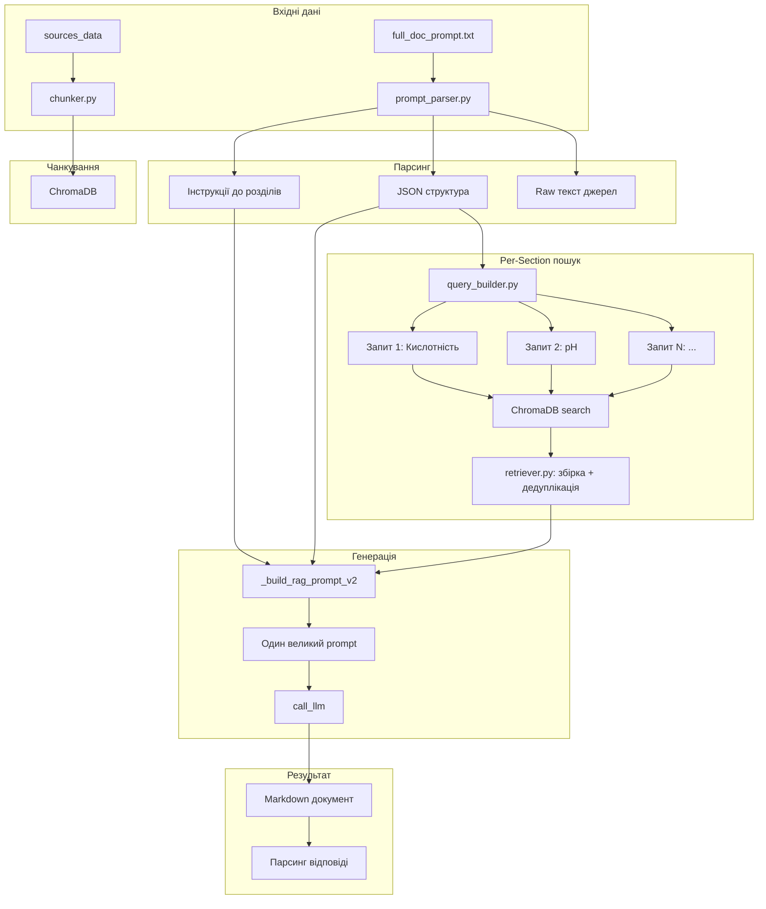

# Per-Section RAG: Підготовка чанків для фінального запиту в LLM

## Узгоджений підхід

**Ідея:** парсимо фінальний промпт самі (не відправляємо в LLM), виділяємо короткі пошукові запити, локально в ChromaDB шукаємо чанки, збираємо всі знайдені чанки в один великий запит і відправляємо одним LLM-запитом.

```
Фінальний промпт (full_doc_prompt.txt)
    │
    ▼
Парсимо локально ──────────────────────────┐
    │                                       │
    ▼                                       │
Виділяємо N коротких запитів (по секції)    │
    │                                       │
    ▼                                       │
Для кожного запиту → ChromaDB → чанки      │
    │                                       │
    ▼                                       │
Збираємо ВСІ чанки в один пул ──────────────┤
    │                                       │
    ▼                                       ▼
Формуємо ОДИН великий запит → LLM → Відповідь
    │
    ▼
Парсимо відповідь (стандартно)
```

---

## Чим відрізняється від поточної RAG-реалізації

| Аспект | Поточний RAG (pipeline.py) | Новий підхід |
|--------|---------------------------|--------------|
| Джерело запитів | `analysis_text` (сира структура шаблону) | **Фінальний промпт** (вже зібраний full_doc_prompt) |
| QueryBuilder | generic: title + description.general + description.specific | **Точні запити**: з JSON-структури, з урахуванням `words` і `level` |
| Пошук | один глобальний пошук, дедуплікація | **N окремих пошуків** в ChromaDB (один на секцію) |
| LLM-запитів | 1 | **1** (те саме) |
| Якість чанків | середня (запити неспецифічні) | **висока** (кожен запит точно під секцію) |

---

## Детальний план імплементації

### Step 0: Підготовка даних (вже є)

- [`chunker.py`](../blueprints/doc_generator/rag/chunker.py) — чанкування джерел вже реалізовано
- [`embedder.py`](../blueprints/doc_generator/rag/embedder.py) — ChromaDB + Ollama вже реалізовано
- [`analysis_parser.py`](../blueprints/doc_generator/parsers/analysis_parser.py) — парсинг JSON-структури вже реалізовано

### Step 1: Парсинг фінального промпту

**Новий файл:** [`rag/prompt_parser.py`](../blueprints/doc_generator/rag/prompt_parser.py)

```python
def parse_full_doc_prompt(prompt_text: str) -> ParsedPrompt:
    """
    Парсить full_doc_prompt.txt і виділяє:
    - Інструкції до розділів (description.general)
    - JSON-структура (секції + таблиці)
    - Текст джерел (якщо є)
    """
    # 1. Знайти блок ## ІНСТРУКЦІЇ ДО РОЗДІЛІВ
    #    Розпарсити: "- Розділ '{title}': {instruction}"
    #    Повернути: dict[title] = instruction
    
    # 2. Знайти блок ## СТРУКТУРА ДОКУМЕНТА
    #    Розпарсити JSON (вже вміє analysis_parser.py)
    #    Повернути: ParsedAnalysis (sections + tables)
    
    # 3. Знайти блок ## ДЖЕРЕЛА
    #    Зберегти як raw text для контексту (опціонально)
```

**Формат вхідних даних** — [`b2fe72d5_full_doc_prompt.txt`](../blueprints/doc_generator/Tasks-data/Лабораторна%20робота%208/ai_responses/b2fe72d5_full_doc_prompt.txt):
```
## ІНСТРУКЦІЇ ДО РОЗДІЛІВ
- Розділ 'Лабораторна робота №8...': інструкція
- Розділ 'ВИМОГИ ДО ЯКОСТІ...': інструкція
...

## СТРУКТУРА ДОКУМЕНТА
[{json структура}]

## ДЖЕРЕЛА
=== Source file ===
текст джерела...
```

### Step 2: Побудова per-section запитів

**Модифікувати:** [`rag/query_builder.py`](../blueprints/doc_generator/rag/query_builder.py)

```python
def build_per_section_queries(parsed_analysis: ParsedAnalysis) -> List[Dict]:
    """
    Для КОЖНОЇ секції будує ТОЧНИЙ пошуковий запит.
    Відрізняється від поточного build_queries():
    - Враховує word_count_range для визначення об'єму потрібних даних
    - Враховує level для ієрархічного контексту
    - Додає батьківський заголовок для кращого контексту
    - Для таблиць — враховує колонки + first_column_data
    """
    queries = []
    for section in parsed_analysis.sections:
        query = build_section_search_query(section, parent_context)
        queries.append(query)
    for table in parsed_analysis.tables:
        query = build_table_search_query(table)
        queries.append(query)
    return queries
```

**Приклад запиту для секції "Визначення кислотності":**
```
Визначення кислотності | нейтралізація водного розчину продукту лугом | титрування 0,01 М розчином гідроксиду натрію з фенолфталеїном | градуси Тернера °Т
```

### Step 3: Пошук чанків per-section

**Модифікувати:** [`rag/retriever.py`](../blueprints/doc_generator/rag/retriever.py)

```python
def retrieve_all_section_chunks(
    queries: List[Dict],
    sources_hash: str,
    top_k: int = 3,
    threshold: float = 0.0
) -> List[Dict]:
    """
    Для КОЖНОГО запиту робить окремий пошук в ChromaDB,
    потім збирає ВСІ чанки в один пул з дедуплікацією.
    
    Відміна від поточного retrieve_for_queries():
    - Поточний: один глобальний пошук, дедуплікація
    - Новий: N окремих пошуків, потім збірка + дедуплікація
    
    Args:
        queries: List[{'section_title', 'query_text'}]
        sources_hash: для ідентифікації колекції
        top_k: чанків на запит
        threshold: мінімальна схожість
        
    Returns:
        List[{'text', 'source', 'similarity', 'matched_section', ...}]
    """
    all_chunks = []
    seen_texts = set()
    
    for q in queries:
        # Окремий пошук в ChromaDB для кожної секції!
        results = embedder.search(
            query=q['query_text'],
            sources_hash=sources_hash,
            top_k=top_k,
            threshold=threshold
        )
        
        # Дедуплікація по тексту (first 100 chars)
        for chunk in results:
            dedup_key = f"{chunk.get('source')}:{chunk.get('text','')[:100]}"
            if dedup_key not in seen_texts:
                seen_texts.add(dedup_key)
                chunk['matched_section'] = q['section_title']
                all_chunks.append(chunk)
    
    # Сортування: спочатку за source, потім за chunk_index
    all_chunks.sort(key=lambda x: (x.get('source',''), x.get('chunk_index',0)))
    
    return all_chunks
```

### Step 4: Формування фінального промпту

**Модифікувати:** [`rag/pipeline.py`](../blueprints/doc_generator/rag/pipeline.py) — функція `_build_rag_prompt()`

Поточний `_build_rag_prompt()` вже майже те що треба:
- Бере `analysis_text` (структура) + `context_text` (всі чанки)
- Форматує в `FULL_DOCUMENT_GENERATION_PROMPT`

**Зміни:**
- Адаптувати, щоб приймав не `analysis_text`, а розпаршений `ParsedAnalysis`
- Додати в контекст інформацію про те, які чанки до якої секції належать (`matched_section`)

```python
def _build_rag_prompt_v2(
    parsed_analysis: ParsedAnalysis,
    all_chunks: List[Dict],
    user_prompt: Optional[str] = None
) -> str:
    """
    Покращена версія _build_rag_prompt().
    
    Відміна від поточної:
    - Приймає вже розпаршений ParsedAnalysis (не треба парсити знову)
    - Чанки згруповані по секціях для кращої читабельності
    - Додає маркери які чанки до якої секції
    """
    # Будуємо структуру JSON (як в поточній версії)
    structure = build_structure_json(parsed_analysis)
    
    # Будуємо інструкції (як в поточній версії)
    instructions = build_instructions_text(parsed_analysis)
    
    # Форматуємо чанки згруповано по секціях!
    context_text = format_chunks_grouped_by_section(all_chunks)
    
    prompt = FULL_DOCUMENT_GENERATION_PROMPT.format(
        instructions=instructions,
        structure=structure,
        sources=context_text
    )
    
    if user_prompt:
        prompt += f"\n\n## ДОДАТКОВІ ВИМОГИ\n\n{user_prompt}"
    
    return prompt


def format_chunks_grouped_by_section(chunks: List[Dict]) -> str:
    """
    Форматує чанки, згруповані по matched_section.
    """
    groups = {}
    for chunk in chunks:
        section = chunk.get('matched_section', 'Загальне')
        if section not in groups:
            groups[section] = []
        groups[section].append(chunk)
    
    parts = []
    for section, section_chunks in groups.items():
        parts.append(f"=== {section} ===")
        for c in section_chunks:
            sim = c.get('similarity', 0)
            text = c.get('text', '')
            parts.append(f"[релевантність: {sim:.2f}]\n{text}\n")
    
    return '\n'.join(parts)
```

### Step 5: Нова функція pipeline

**Модифікувати:** [`rag/pipeline.py`](../blueprints/doc_generator/rag/pipeline.py) — нова функція

```python
def generate_document_rag_enhanced(
    full_prompt_text: str,  # <- замість analysis_text беремо full_doc_prompt
    sources_data: Dict[str, Dict[str, Any]],
    task_id: str = "unknown",
    user_prompt: Optional[str] = None,
    task_folder: Optional[str] = None,
    selected_model: Optional[str] = None,
    chunk_params: Optional[Dict[str, Any]] = None
) -> str:
    """
    Покращений RAG pipeline.
    
    Відміна від generate_document_rag():
    1. Парсить full_doc_prompt замість analysis_text
    2. Будує per-section запити (точніші)
    3. N окремих пошуків в ChromaDB
    4. Збирає всі чанки в один prompt
    5. Один LLM-запит
    """
    # Step 1: Парсимо full_doc_prompt
    parsed = parse_full_doc_prompt(full_prompt_text)
    
    # Step 2: Чанкуємо джерела (як зараз)
    chunks = chunk_documents(sources_data, min_chunk_size, max_chunk_size)
    
    # Step 3: Будуємо ChromaDB (як зараз)
    embedder.build(chunks, sources_hash)
    
    # Step 4: Будуємо per-section запити
    queries = build_per_section_queries(parsed.parsed_analysis)
    
    # Step 5: N окремих пошуків → всі чанки
    all_chunks = retrieve_all_section_chunks(queries, sources_hash, top_k, threshold)
    
    # Step 6: Один промпт → один LLM-запит
    prompt = _build_rag_prompt_v2(parsed.parsed_analysis, all_chunks, user_prompt)
    
    # Step 7: LLM
    result = call_llm(prompt, task_id, task_folder, selected_model)
    
    return result
```

---

## Зміни в файлах

| Файл | Тип змін | Опис |
|------|----------|------|
| [`rag/prompt_parser.py`](../blueprints/doc_generator/rag/prompt_parser.py) | **Новий** | Парсинг full_doc_prompt → структура + інструкції |
| [`rag/query_builder.py`](../blueprints/doc_generator/rag/query_builder.py) | **Модифікація** | Додати `build_per_section_queries()` — точні запити з урахуванням word_count, level, parent |
| [`rag/retriever.py`](../blueprints/doc_generator/rag/retriever.py) | **Модифікація** | Додати `retrieve_all_section_chunks()` — N пошуків + збірка |
| [`rag/pipeline.py`](../blueprints/doc_generator/rag/pipeline.py) | **Модифікація** | Додати `generate_document_rag_enhanced()`, оновити `_build_rag_prompt_v2()` |
| [`reasoning/generator.py`](../blueprints/doc_generator/reasoning/generator.py) | **Без змін** | `call_llm()` використовується як є |

---

## Mermaid: повний flow



---

## Чому цей підхід кращий

1. **Один LLM-запит** — дешевше і швидше ніж N окремих
2. **Точніші чанки** — per-section пошук дає релевантніші дані ніж глобальний
3. **LLM бачить всі дані** — може зробити кращий документ з повним контекстом
4. **Мінімальні зміни** — більшість компонентів вже є, додаємо тільки `prompt_parser.py` + модифікуємо існуючі
5. **Зворотна сумісність** — старий `generate_document_rag()` не змінюється
