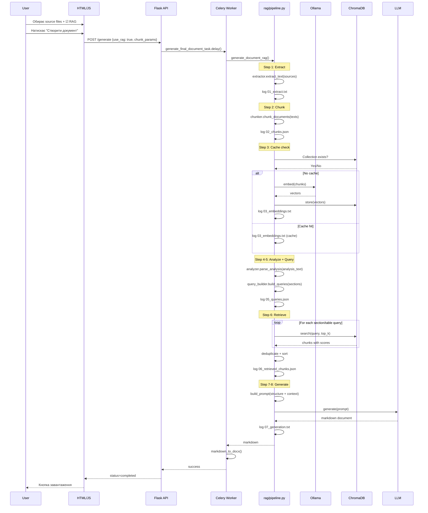

# План впровадження RAG-режиму для Doc Generator

## Огляд

Новий RAG-режим (Chunks) додається як **альтернатива** поточному повному режиму (Full).
Перемикання — простий чекбокс в UI. Існуючий функціонал **не змінюється**.

## Архітектура

```
┌─────────────────────────────────────────────────────┐
│                   index-doc-generator.html           │
│  [✔] Використовувати RAG (через чанки)              │
│  ┌─────────────────────────────────────────────────┐ │
│  │ [Параметри чанкування] (видно тільки при RAG)   │ │
│  │   • Режим: paragraph (тільки один)              │ │
│  │   • Min chunk: 100 слів                         │ │
│  │   • Max chunk: 800 слів                         │ │
│  │   • Top-K: 3 чанки на розділ                    │ │
│  │   • Threshold: 0.6                              │ │
│  └─────────────────────────────────────────────────┘ │
└─────────────────────────────────────────────────────┘
                           │
                           ▼
┌─────────────────────────────────────────────────────┐
│                   routes.py                          │
│  generate_final_document_task()                     │
│  if use_rag:                                        │
│      → generate_document_rag()                      │
│  else:                                              │
│      → generate_document_full() (як зараз)          │
└─────────────────────────────────────────────────────┘
                           │
                           ▼
┌─────────────────────────────────────────────────────┐
│          rag/pipeline.py (новий оркестратор)        │
│                                                     │
│  1. extract_text()     ← source_parser.py (існ.)   │
│  2. chunk_documents()  ← chunker.py (новий)        │
│  3. build_vectorstore()← embedder.py (новий)        │
│  4. load_analysis()    ← analysis_parser.py (існ.)  │
│  5. build_queries()    ← query_builder.py (новий)   │
│  6. retrieve_chunks()  ← retriever.py (новий)       │
│  7. generate_doc()     ← generator.py (модиф.)      │
│                                                     │
│  Кожен крок → логування в rag_logs/ + debug_log     │
└─────────────────────────────────────────────────────┘
```

## Структура нових файлів

```
blueprints/doc_generator/
├── rag/                                     # НОВА ПАПКА
│   ├── __init__.py                          # Експорт pipeline
│   ├── pipeline.py                          # Оркестратор RAG-процесу
│   ├── chunker.py                           # Чанкування тексту (paragraph mode)
│   ├── embedder.py                          # Ollama nomic-embed-text + ChromaDB
│   ├── retriever.py                         # Пошук + дедублікація + контекст
│   └── query_builder.py                     # Побудова підзапитів із структури
├── data/
│   └── chroma_db/                           # ChromaDB persistent storage
├── Tasks-data/
│   └── {task_id}/
│       ├── rag_logs/                        # Логи кожного кроку RAG
│       │   ├── 01_extract.txt               # Результат екстракції
│       │   ├── 02_chunks.json               # Чанки з метаданими
│       │   ├── 03_embeddings.txt            # Час ембедінгу, к-сть чанків
│       │   ├── 04_analysis.txt              # Структура з analysis_parser
│       │   ├── 05_queries.json              # Сгенеровані підзапити
│       │   ├── 06_retrieved_chunks.json     # Знайдені чанки з scores
│       │   └── 07_generation.txt            # Розмір контексту, модель
│       └── ... (існуючі файли)
└── config.py                                # + RAG налаштування за замовчуванням
```

## Детальний план по кроках

### Фаза 0: Прототип (оцінка швидкості)

Створити окремий скрипт `rag/benchmark.py` який:

1. Бере один source-файл (наприклад "Лабораторна робота 8.pdf")
2. Екстрактує текст (перевикористовує `source_parser.py`)
3. Чанкує (paragraph mode, 100-800 слів)
4. Викликає Ollama `nomic-embed-text` для ембедінгу
5. Зберігає в ChromaDB
6. Виконує тестовий пошук
7. **Виводить час кожного кроку**

Це дозволить оцінити чи реально працювати на наявному залізі.
Якщо швидкість прийнятна → переходимо до Фази 1.

### Фаза 1: Бекенд — нові модулі

#### 1.1 `rag/chunker.py` — чанкування тексту (режим paragraph)

```
Вхід: текст + параметри (min_chunk_size=100, max_chunk_size=800)
Вихід: List[Chunk] де Chunk = {text, source_file, chunk_index, word_count}

Алгоритм:
  1. Розбити по \n\n (абзаци)
  2. Якщо абзац < min_chunk_size слів → злити з наступним
  3. Якщо абзац > max_chunk_size слів → розбити по реченнях
  4. Додати source_file та chunk_index до кожного чанка
  5. Повернути список чанків
```

Логування: зберігає `02_chunks.json` в `rag_logs/` з кожним чанком і його метаданими.

#### 1.2 `rag/embedder.py` — ембедінг + ChromaDB

```
Використовує Ollama nomic-embed-text:
  - Виклик: curl -X POST http://localhost:11434/api/embed
    -d '{"model": "nomic-embed-text", "input": ["text1", "text2", ...]}'

ChromaDB:
  - Глобальне сховище: data/chroma_db/
  - Колекції: назва = hash(sorted source filenames)
  - При перевірці: якщо колекція існує з тими ж файлами — skip
  - Batch embedding: по 10-20 чанків за раз (щоб не завалити Ollama)
```

Логування: час ембедінгу, кількість чанків, розмір колекції.

Час виконання для оцінки:
- 100 чанків × ~0.5-1 сек на batch з 20 = ~5 запитів до Ollama
- На CPU: ~5-15 секунд (залежить від заліза)

#### 1.3 `rag/query_builder.py` — побудова підзапитів

```
Вхід: parsed_analysis (з analysis_parser.py) — секції + таблиці
Вихід: List[Query] де Query = {section_title, query_text, table_info?}

Логіка:
  - Для кожної текстової секції: заголовок + description_general → пошуковий запит
  - Для кожної таблиці: назва + колонки → окремий запит
  - Мова: українська (збігається з документами)
```

Логування: `05_queries.json` з усіма згенерованими запитам.

#### 1.4 `rag/retriever.py` — пошук + дедублікація + формування контексту

```
Вхід: список запитів, task_id, top_k, threshold
Вихід: context_text (рядок зі знайденими чанками для LLM)

Логіка:
  1. Для кожного запиту → ChromaDB similarity search
  2. Зібрати всі знайдені чанки в один пул
  3. Дедублікація: по тексту чанка (якщо overlap > 80% — тільки один)
  4. Сортування: по source_file + chunk_index (щоб зберегти логіку документа)
  5. Обмеження: максимум N чанків (щоб не перевищити контекст LLM)
  6. Форматування для LLM:
     [Source: filename.pdf | Chunk 3/15]
     текст чанка...
```

Логування: `06_retrieved_chunks.json` — кожен знайдений чанк з source, chunk_index, similarity score.

#### 1.5 `rag/pipeline.py` — оркестратор

```python
def generate_document_rag(
    analysis_text, sources_data, task_id,
    user_prompt, task_folder, selected_model,
    chunk_params
) -> str:  # returns markdown

    steps:
    1. extract_text(sources_data) → combined text + per-source stats
       log: 01_extract.txt

    2. chunk_documents(sources_data, chunk_params) → List[Chunk]
       log: 02_chunks.json

    3. build_vectorstore(chunks, task_id, sources_hash) → collection_name
       check cache: if collection exists with same hash → skip
       log: 03_embeddings.txt

    4. load_analysis(analysis_text) → ParsedAnalysis
       log: 04_analysis.txt

    5. build_queries(parsed_analysis) → List[Query]
       log: 05_queries.json

    6. retrieve_chunks(queries, collection_name, top_k, threshold) → context_text
       deduplication + limit
       log: 06_retrieved_chunks.json

    7. build_rag_prompt(analysis_text, context_text, user_prompt) → final_prompt
       (аналогічно FULL_DOCUMENT_GENERATION_PROMPT, але замість sources_block — context_text)

    8. call_llm(prompt, selected_model) → markdown
       log: 07_generation.txt

    9. return markdown
```

### Фаза 2: Інтеграція з існуючим кодом

#### 2.1 `routes.py` — модифікація `generate_final_document_task`

```python
# Додати параметр use_rag в API
@doc_generator_bp.route('/api/tasks/<task_id>/generate', methods=['POST'])
def generate_document(task_id):
    data = request.get_json()
    use_rag = data.get('use_rag', False)  # НОВИЙ параметр
    chunk_params = data.get('chunk_params', {})  # НОВИЙ параметр
    # ...
    result = generate_final_document_task.delay(
        task_id, folder_path, generation_prompt, source_files,
        use_rag=use_rag, chunk_params=chunk_params  # НОВЕ
    )
```

#### 2.2 `generator.py` — нова функція `build_rag_prompt()`

```python
RAG_DOCUMENT_GENERATION_PROMPT = """..."""
# Аналогічно FULL_DOCUMENT_GENERATION_PROMPT,
# але з контекстом з RAG замість повних джерел
```

Або простіше: передавати context_text в параметр `sources` існуючого `FULL_DOCUMENT_GENERATION_PROMPT`. Так мінімум змін.

### Фаза 3: UI

#### 3.1 HTML — додати чекбокс і параметри

```html
<!-- Режим роботи -->
<div class="form-group">
  <label>
    <input type="checkbox" id="use-rag" onchange="toggleRagParams()">
    Використовувати RAG (через чанки)
  </label>
</div>

<!-- Параметри чанкування (приховані, показуються при use-rag) -->
<div id="rag-params" style="display:none">
  <div class="form-group">
    <label>Мінімум слів у чанку: <span id="min-chunk-val">100</span></label>
    <input type="range" id="min-chunk" min="50" max="300" value="100">
  </div>
  <div class="form-group">
    <label>Максимум слів у чанку: <span id="max-chunk-val">800</span></label>
    <input type="range" id="max-chunk" min="200" max="2000" value="800">
  </div>
  <div class="form-group">
    <label>Чанків на розділ: <span id="top-k-val">3</span></label>
    <input type="range" id="top-k" min="1" max="10" value="3">
  </div>
  <div class="form-group">
    <label>Точність пошуку: <span id="threshold-val">0.6</span></label>
    <input type="range" id="threshold" min="0" max="100" value="60">
  </div>
</div>
```

#### 3.2 JavaScript — передача параметрів

```javascript
async function generateDocument() {
    const useRag = document.getElementById('use-rag').checked;
    const chunkParams = useRag ? {
        mode: 'paragraph',
        min_chunk_size: parseInt(document.getElementById('min-chunk').value),
        max_chunk_size: parseInt(document.getElementById('max-chunk').value),
        top_k: parseInt(document.getElementById('top-k').value),
        threshold: parseInt(document.getElementById('threshold').value) / 100
    } : {};
    
    await fetch(`${API_BASE}/api/tasks/${taskId}/generate`, {
        method: 'POST',
        headers: {'Content-Type': 'application/json'},
        body: JSON.stringify({
            generation_prompt: generationPrompt,
            source_files: selectedSources,
            use_rag: useRag,
            chunk_params: chunkParams
        })
    });
}
```

### Фаза 4: Кешування

**Стратегія (оптимальна за швидкістю):**

1. **Хеш файлів**: SHA256 від відсортованого списку імен source-файлів + їх `os.path.getmtime()`
   - Швидко: не треба читати вміст файлів
   - Достатньо: якщо файл змінився — mtime інший → новий хеш → перебудова

2. **Назва колекції**: `rag_{sources_hash[:16]}`

3. **Перевірка при старті генерації**:
   ```python
   sources_hash = compute_sources_hash(source_files)
   collection_name = f"rag_{sources_hash[:16]}"
   
   if chroma_collection_exists(collection_name):
       # Зчитати metadata → перевірити чи файли ті самі
       log("Кеш знайдено, пропускаємо ембедінг")
   else:
       # Видалити стару колекцію для цього task_id (якщо є)
       # Побудувати нову
       log("Будуємо нову векторну базу...")
   ```

4. **Metadata колекції**:
   ```json
   {
     "sources_hash": "a1b2c3d4...",
     "created_at": "2026-05-07T17:30:00",
     "source_files": ["file1.pdf", "file2.docx"],
     "total_chunks": 42,
     "chunk_params": {"mode": "paragraph", "min_size": 100, "max_size": 800}
   }
   ```

## Критичні моменти

1. **ChromaDB не встановлено** — потребує `pip install chromadb`
2. **Ollama nomic-embed-text** — потребує `ollama pull nomic-embed-text` (модель ~274MB)
3. **Дедлайн оцінки**: весь прототип (Фаза 0) займе ~1-2 години
4. **Fallback**: якщо RAG не знайшов релевантних чанків — автоматичний перехід у FULL режим з попередженням

## Діаграма послідовності



## Поетапний TODO

### Етап 0: Прототип швидкості
- [ ] Створити `rag/benchmark.py` для тестування
- [ ] Встановити chromadb (`pip install chromadb`)
- [ ] Завантажити nomic-embed-text (`ollama pull nomic-embed-text`)
- [ ] Протестувати на 1 файлі: час чанкування + ембедінгу + пошуку
- [ ] Вирішити чи рухатися далі

### Етап 1: Нові модулі
- [ ] `rag/__init__.py` — експорт функцій
- [ ] `rag/chunker.py` — чанкування (режим paragraph)
- [ ] `rag/embedder.py` — Ollama + ChromaDB з кешуванням
- [ ] `rag/query_builder.py` — побудова підзапитів
- [ ] `rag/retriever.py` — пошук + дедублікація + форматування
- [ ] `rag/pipeline.py` — оркестратор `generate_document_rag()`

### Етап 2: Інтеграція
- [ ] `routes.py` — додати параметр `use_rag` в API та Celery task
- [ ] Модифікувати `generate_final_document_task` для виклику RAG-потоку
- [ ] Додати `RAG_DOCUMENT_GENERATION_PROMPT` або адаптувати існуючий

### Етап 3: UI
- [ ] Додати чекбокс "Використовувати RAG" в HTML
- [ ] Додати панель параметрів чанкування (прихована/показана)
- [ ] JavaScript: передача `use_rag` + `chunk_params` в API
- [ ] Оновлення логування в UI для RAG-кроків

### Етап 4: Фіналізація
- [ ] Тестування: FULL режим не зламався
- [ ] Тестування: RAG режим працює
- [ ] Тестування: кешування працює (повторний запуск швидший)
- [ ] Перевірка логів: кожен крок видно в UI
- [ ] Fallback: якщо RAG не знайшов дані → FULL режим
