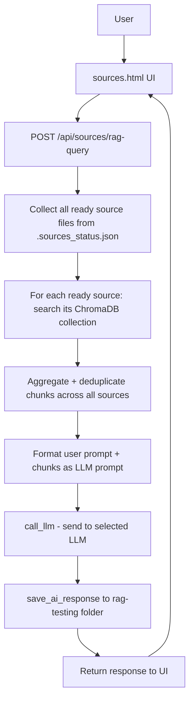
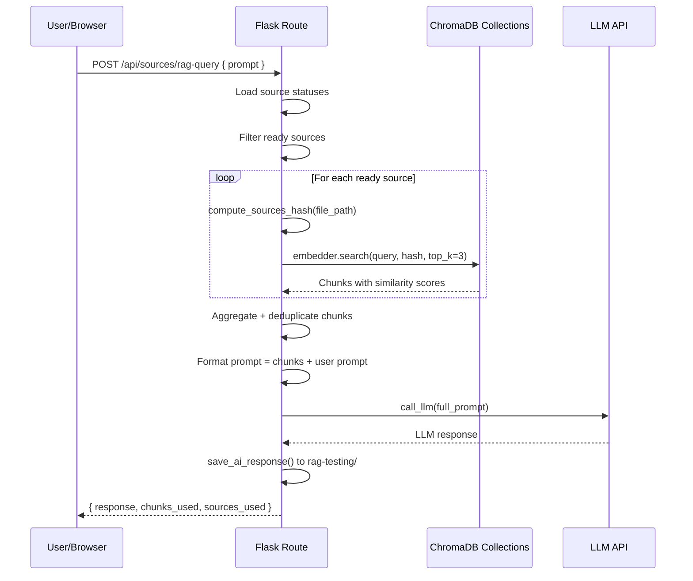

# RAG Query on Sources Page — Implementation Plan

## Goal
Add a RAG-based prompt analysis feature to the sources management page, allowing users to query all processed source documents via natural language prompt and get an LLM-generated answer based on relevant chunks retrieved from ChromaDB.

---

## Architecture Overview



## Key Observation: ChromaDB Collections are Per-File

Each source file has its **own ChromaDB collection** (hash computed from single file path + mtime). When a user queries "all sources", we must:

1. Get all files with `status: 'ready'` from `.sources_status.json`
2. For each file, compute its hash, check if collection exists
3. Search each collection with the user's prompt
4. Aggregate and deduplicate results across all collections

---

## Implementation Steps

### 1. Create `rag-testing` directory

- Path: `blueprints/doc_generator/Tasks-data/rag-testing/`
- This is where `save_ai_response` will save prompt+chunks and LLM response
- No code changes needed — `save_ai_response` auto-creates `ai_responses/` subfolder when given a `task_folder`

### 2. Add new API endpoint in `routes.py`

**Endpoint:** `POST /api/sources/rag-query`

**Request body:**
```json
{
  "prompt": "Which legal documents cover data protection?"
}
```

**Response:**
```json
{
  "response": "Based on the analyzed sources...",
  "chunks_used": 5,
  "sources_used": ["doc1.pdf", "doc2.docx"]
}
```

**Logic (as a synchronous route, not Celery — since this is interactive):**

1. Load all source statuses from `.sources_status.json`
2. Filter for files with `status == 'ready'`
3. For each ready source file:
   - Compute its hash using `compute_sources_hash([file_path])`
   - Check if ChromaDB collection exists via `embedder.collection_exists(hash)`
   - If exists, call `embedder.search(query=user_prompt, sources_hash=hash, top_k=3)`
   - Collect results
4. Aggregate all results across sources, deduplicate by text content (first 100 chars + source)
5. Sort by similarity descending, keep top N (e.g., top 10 most relevant)
6. Format context using `Retriever.format_context_for_llm(chunks)` or custom formatting
7. Build the LLM prompt:
   ```
   Система: Ти — аналітик, який відповідає на запитання на основі наданих фрагментів документів.
   
   Фрагменти джерел:
   {formatted_chunks}
   
   Запитання користувача:
   {user_prompt}
   
   Відповідь українською мовою, посилаючись на джерела.
   ```
8. Call `call_llm(prompt=full_prompt, task_id="rag-query", task_folder=rag_testing_folder, response_type="rag_query")`
9. Save user prompt (including chunks) + LLM response via `save_ai_response()`
10. Return response + metadata to UI

**Important:** Wrap in `try/except` with meaningful error messages. If no sources are ready, return a clear message.

### 3. Update `sources.html` — Add RAG Query UI Section

Add a new section **below** the existing sources list:

```html
<!-- RAG Query Section -->
<div class="rag-query-section" style="margin-top: 30px;">
    <h2>🔍 RAG-аналіз джерел</h2>
    
    <div class="rag-query-card">
        <textarea id="rag-prompt-input" 
                  placeholder="Введіть запит до всіх джерел..."
                  rows="4"></textarea>
        
        <div style="display: flex; gap: 10px; margin-top: 10px;">
            <button class="btn-primary" id="btn-rag-query" onclick="runRagQuery()">
                🔍 Аналізувати промпт
            </button>
            <span id="rag-status" style="align-self: center; font-size: 0.9em; color: #666;"></span>
        </div>
        
        <div id="rag-response-section" style="display: none; margin-top: 15px;">
            <div style="margin-bottom: 5px; font-weight: 600; color: #555;">
                Відповідь:
                <span id="rag-meta" style="font-weight: normal; font-size: 0.85em; color: #888;"></span>
            </div>
            <div id="rag-response-content" class="rag-response-box">
                <!-- Response will appear here -->
            </div>
        </div>
    </div>
</div>
```

**CSS additions** (in the existing `<style>` block):
```css
.rag-query-section { /* ... */ }
.rag-query-card {
    background: white;
    padding: 20px;
    border-radius: 8px;
    box-shadow: 0 2px 4px rgba(0,0,0,0.1);
}
.rag-query-card textarea {
    width: 100%;
    padding: 12px;
    border: 1px solid #ddd;
    border-radius: 6px;
    font-size: 14px;
    resize: vertical;
}
.rag-response-box {
    background: #f8f9fa;
    border: 1px solid #e0e0e0;
    border-radius: 6px;
    padding: 15px;
    white-space: pre-wrap;
    font-size: 14px;
    line-height: 1.5;
    max-height: 500px;
    overflow-y: auto;
}
```

**JavaScript function** `runRagQuery()`:
```javascript
async function runRagQuery() {
    const prompt = document.getElementById('rag-prompt-input').value.trim();
    if (!prompt) {
        showToast('Введіть запит для аналізу', 'error');
        return;
    }
    
    const btn = document.getElementById('btn-rag-query');
    const status = document.getElementById('rag-status');
    const responseSection = document.getElementById('rag-response-section');
    const responseContent = document.getElementById('rag-response-content');
    const meta = document.getElementById('rag-meta');
    
    btn.disabled = true;
    btn.innerHTML = '<span class="loading"></span> Аналіз...';
    status.textContent = 'Пошук релевантних фрагментів...';
    responseSection.style.display = 'none';
    
    try {
        const response = await fetch(`${API_BASE}/api/sources/rag-query`, {
            method: 'POST',
            headers: { 'Content-Type': 'application/json' },
            body: JSON.stringify({ prompt })
        });
        
        const result = await response.json();
        
        if (result.response) {
            responseContent.textContent = result.response;
            meta.textContent = `(використано ${result.chunks_used} фрагментів з ${result.sources_used?.length || 0} джерел)`;
            responseSection.style.display = 'block';
            status.textContent = '';
        } else {
            showToast(result.error || 'Помилка аналізу', 'error');
            status.textContent = '';
        }
    } catch (e) {
        showToast(`Помилка: ${e.message}`, 'error');
        status.textContent = '';
    }
    
    btn.disabled = false;
    btn.innerHTML = '🔍 Аналізувати промпт';
}
```

### 4. Update imports in `routes.py`

Add to existing imports:
```python
from .rag.embedder import Embedder, compute_sources_hash
from .rag.retriever import Retriever
from .reasoning.generator import call_llm, save_ai_response
from .source_processor import get_source_status
```

### 5. Data flow diagram



---

## Files to Modify

| File | Change |
|------|--------|
| `blueprints/doc_generator/routes.py` | Add new `POST /api/sources/rag-query` endpoint |
| `blueprints/doc_generator/templates/doc_generator/sources.html` | Add RAG query UI section (HTML, CSS, JS) |

## Files to Create

| File | Purpose |
|------|---------|
| `blueprints/doc_generator/Tasks-data/rag-testing/` | Directory for saving RAG query prompts + responses via `save_ai_response` |

---

## Error Handling

1. **No ready sources:** Return `{ "response": null, "error": "Немає оброблених джерел. Спочатку обробіть джерела." }`
2. **No relevant chunks found:** Still send prompt to LLM with message "Не знайдено релевантних фрагментів у джерелах"
3. **LLM error:** Return descriptive error message
4. **Ollama/Embedding unavailable:** Return connection error message

---

## Edge Cases

- **Empty prompt:** Client-side validation before sending
- **Single source with many chunks:** Limit to top_k=3 per source, top 10 total
- **Source deleted after being marked ready:** Hash check will fail → skip gracefully
- **Very long prompts:** The existing `call_llm` handles token limits
- **Concurrent queries:** Each request is independent (no state mutation)

---

## Testing

1. Upload 2-3 documents → wait for processing
2. Enter a prompt related to the documents
3. Verify chunks are retrieved from all sources
4. Verify LLM response references the source documents
5. Check `Tasks-data/rag-testing/ai_responses/` for saved prompt/response files
6. Test with empty sources
7. Test with sources that have no relevant content for the prompt
